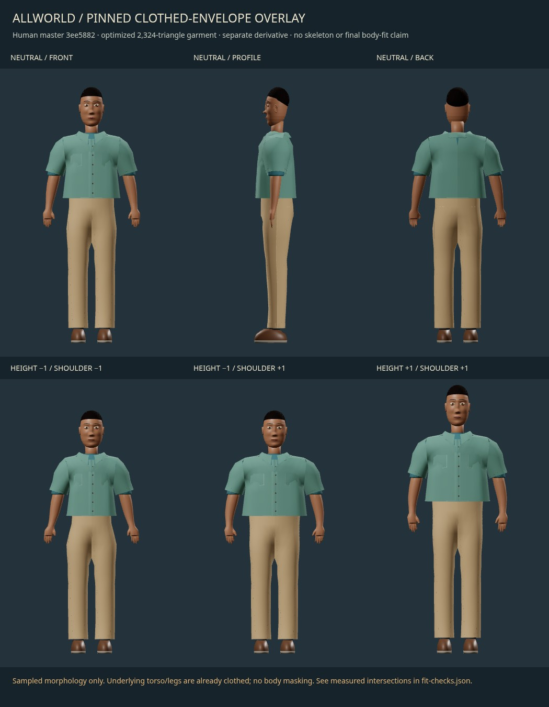

# Latest continuation: optimized wardrobe and frozen-envelope study

This is the current handoff, following the historical first-art `CONTINUE.md` and optimization `OPTIMIZATION-CONTINUE.md`. Parent explicitly authorized the optimization and supplied frozen human commit **3ee5882c8efde54c00fddaa6cbdbc8d1bca48b8a** for bounded envelope/morph tests. Branch remains `codex/cloud-human-wardrobe-art-20261013`, based on integration **caaee5e1b91afc7f3cd3f2124df3547dc7f492ec**. Only this lane's documentation/experiment prefixes changed. No shared runtime, human master, main, deployment, caps, wardrobe IDs, inventory, masks or new workers were touched.

## View the tangible results



- [High versus game-resolution neutral comparison](../../../../experiments/cloud-lanes/human-wardrobe-art/game-resolution-v1/artifacts/high-vs-game-neutral.jpg) and [close-up tradeoffs](../../../../experiments/cloud-lanes/human-wardrobe-art/game-resolution-v1/artifacts/high-vs-game-detail.jpg), inspected under matched raw GLTFLoader lighting.
- [Editable optimized fixture source](../../../../experiments/cloud-lanes/human-wardrobe-art/game-resolution-v1/artifacts/everyday-01-game-v1-editable.blend) and [garment-only GLB](../../../../experiments/cloud-lanes/human-wardrobe-art/game-resolution-v1/artifacts/everyday-01-game-v1.glb).
- [Editable frozen-envelope derivative](../../../../experiments/cloud-lanes/human-wardrobe-art/envelope-fit-v1/artifacts/everyday-01-envelope-v1-editable.blend) and [garment-only GLB with two real morph targets](../../../../experiments/cloud-lanes/human-wardrobe-art/envelope-fit-v1/artifacts/everyday-01-envelope-v1.glb).

The .blend contains 73 separate editable garment pieces and a clearly separated, unchanged copy of the 31 frozen human meshes. The GLB contains garments only, one primitive/material, two POSITION morph targets and no skeleton. Load the exact frozen human GLB alongside it at identity transform for the pictured comparison. Coordinates are Blender metres X character-left/Z-up/-Y-front; glTF X-left/Y-up/+Z-front. No production body replacement is included.

## Delivery and Library identity

Early high-detail checkpoint **9c8e65962f7cb2cb245ae66f37e5b6ec3cdaafbc** was 4.834 MiB. Verification checkpoint **fd569373bba6c8d7f0fb946c05e88876ca6d365b** followed. Optimization checkpoint **0385d1fc** was pushed before fitting. The final exact SHA is in the task response; verify it against `git ls-remote` before resuming.

The requested existing sneak peek was saved **before optimization, without rerendering**, as `Allworld - static tailoring-form prototype - optimization pending.jpg`: Library **libfile_2ff1a111c56c8191b7321be3f88ca0af**, file **file_00000000e95081f7ae83481c15e555fe**, version 0, 158,156 bytes. That Library image intentionally remains the original static form checkpoint. The newer comparison/fitted images are in this branch; they did not overwrite the user's Library item.

## Costs and unchanged budgets

Current main was inspected read-only at **1e8107d1f42e2b39de6b2b4fc866679c672996f9**. Its wardrobe code matches the integration-base files: `geometry.ts:213` limits a whole combination to 3,000 triangles; line 147’s 4,000-item ceiling does not override it. The renderer specifies one added draw, one vertex-colour material, roughness .86 and no new textures. Exact hashes are in `game-resolution-v1/receipts/budget-inputs.json`.

| Garment-only measurement | Original authoring | Game fixture v1 | Frozen-envelope v1 |
|---|---:|---:|---:|
| Triangles | 144,840 | 2,328 | **2,324** |
| Draw primitives | 102 | 1 | **1** |
| Materials | 5 | 1 | **1** |
| Texture images / encoded bytes | 3 /177,211 | 0 /0 | **0 /0** |
| Decoded base geometry bytes | 3,513,968 | 83,304 | **83,136** |
| Decoded POSITION morph bytes | 0 | 0 | **46,128** |
| POSITION morph targets | 0 | 0 | **2** |
| Skin bindings / clips | 0 /0 | 0 /0 | **0 /0** |

Final garment GLB **124,452bytes**, SHA-256 **8737a23dc58c9ac950cbfe4b42d6237756fdb02bfbe0cee37af292806d68c77c**. Base+expanded morph arrays total 129,264 bytes; actual glTF buffer is 121,824 bytes because sparse targets differ from fully decoded arrays. Final editable .blend **1,060,170bytes**, SHA-256 **70d1204246c026bc032880735cad9bb63f00b47a11e4378499804d787176f727**, includes the separately identified frozen human copy. The high GLB’s 3,808,680 bytes also includes fixture geometry; its full-file byte ratio is not a pure garment comparison.

Both new GLBs validate with **0 errors /0 warnings /0 infos**. The original 38 tangent-space warnings remain preserved in the old source packet; the new zero-texture vertex-colour material requires no normal-map tangents. This deliberately trades away fine weave. No runtime byte budget is claimed for future weights, wardrobe shader attributes, complete actors or scenes.

## Actual fit evidence and its limits

Frozen `fit-frame.json` SHA-256 **51fae932279d1513e16c4d06ce633f6218a994fe6c224bc3436e105cc519083b**. Source .blend **36018022ff64367e7426069d7417625a3591f3a2c0684c628c11c3bd908f84d9**, GLB **5f0f8da1f3e6b14fc4910f04f02ed1eafe6446f896f44ef2b3a23f2ca071bc07**. `game-resolution-v1/receipts/human-input-verification.json` pins these plus the producer's geometry/UV/morph measurement packet and construction code. Original inputs reside under ignored `runs/frozen-human-3ee5882/`; they were never rebuilt or edited.

Reopening the final derivative independently confirms **all 31 body meshes retain exact position, ordered-triangle, UV and every morph-delta hash** from the producer. See `envelope-fit-v1/receipts/fit-diagnosis.json`. Producer geometry remains the independent human task's work, credited to task 01a13667-6b47-7763-b71a-7d06139ed03f at the exact commit; it is not wardrobe-authored anatomy. All source/derivative contributions remain under repository AGPL-3.0-or-later. No external/purchased/scanned art was introduced.

Tests in `fit-checks.json`: **17 discrete states** = neutral, min/max of all six implemented identity controls, and all four body.height/body.shoulderWidth corner combinations. The final measurements in every state show:

- Zero broad-phase overlapping triangle pairs and zero confirmed segment/triangle crossing pairs against all 31 supplied human surfaces.
- Zero negative nearest-normal samples beyond 0.1 mm at garment vertices/triangle centroids. Worst sampled signed nearest-normal clearance is approximately **2.79 mm**. This is a local sample diagnostic, not a global/continuous clearance certificate.
- Zero near-zero-area triangles and zero triangle orientation reversals relative to neutral.

The four nose/ear controls affect the supplied body while leaving garment coordinates unchanged. Garments export only the producer's relevant **body.height** and **body.shoulderWidth** fields, with the producer's actual signed [-1,1] rules. There is no competing identity control or skeleton. Independent exported-byte checks read real sparse morph buffers and verify finite/nondegenerate geometry for the nine distinct garment neutral/body-endpoint/corner states. Browser evidence renders neutral front/profile/back plus three combinations; all six requested views were visually inspected. Neutral expressions keep the producer's height×expression corrective terms at zero.

**Not final wearable fit:** the human input contains a clothed torso/leg envelope, not a naked torso/leg master, and has no skeleton. No arm/knee bend, locomotion, cloth simulation, garment self-intersection guarantee, body-mask adoption, current-game route, physical-phone or continuous-between-samples acceptance exists. POSITION-only morphs omit normal morphs, so shading under shape changes is approximate. Source edge-length ratios at body extremes range approximately **0.737–1.266**; local detail can compress 26% or stretch 27%. These are geometric edge changes, not fabric-strain validation. The two retopologized gusset fans are explicitly excluded from old-cage edge correspondence.

## Retained failure/review history and visual tradeoffs

The optimization uses chosen regular panel sampling, linear-space vertex-colour baking and visible edge returns, not blind decimation. Shape, collar, pockets, placket and coarse seams survive; fine weave, duplicate stitch rows, thread loops, hidden full shells and belt loops do not. Close-up realism still needs collar/shoulder refinement; silhouettes are more faceted and pocket volume is reduced. The constrained material cannot reproduce the original fine fabric look.

The first envelope attempt visibly produced shoulder spikes and 255 neutral / 258 extreme crossing pairs; its inspected render is `initial-rejected-envelope-fit.jpg`. Recutting sleeve caps and armholes plus directional rise projection removed the spikes and all trouser crossings, leaving 79 neutral pairs at sleeves/front shoulder/collar. The next bounded edge/vertex clearance pass removed sampled crossings but exposed four pre-existing collapsed gusset-tip triangles from the recut. The final explicit armpit fan repair removes those four triangles, reducing 2,328 → 2,324; no zero-area triangles were hidden by the report. Failure/intermediate receipts are retained, including the initial import guard that rejected extra studio objects before fitting. Import now uses only the producer's31 explicitly measured mesh names.

## Reproduction and next steps

Do not rerun unchanged full suites. Original high source files and its 50-file hash manifest still verify unchanged. New delivered bytes are sealed by `OPTIMIZATION-FIT-SHA256SUMS.json` plus `verify_optimization_fit.py`. Three.js 0.180.0 and validator 2.0.0-dev.3.10 stay task-local/ignored with exact dependency lock; no global settings/install changes.

For a fresh checkout, fetch the exact human commit, then materialize its verified bytes into owned ignored scratch. The helper uses `git show` only and never follows a branch:

```sh
git fetch origin 3ee5882c8efde54c00fddaa6cbdbc8d1bca48b8a
python experiments/cloud-lanes/human-wardrobe-art/envelope-fit-v1/materialize_frozen_inputs.py
python experiments/cloud-lanes/human-wardrobe-art/verify_packet.py
python experiments/cloud-lanes/human-wardrobe-art/verify_optimization_fit.py
```

If editing garments, run only relevant bounded jobs from worktree root, sequentially:

```sh
NODE_OPTIONS=--max-old-space-size=128 node scripts/agent-slot.ts heavy --wait-ms 1000 -- python experiments/cloud-lanes/human-wardrobe-art/bounded_run.py --seconds 120 --receipt experiments/cloud-lanes/human-wardrobe-art/envelope-fit-v1/receipts/next-fit.json -- blender --background --threads 2 --python-exit-code 1 --python experiments/cloud-lanes/human-wardrobe-art/envelope-fit-v1/fit_envelope.py
python experiments/cloud-lanes/human-wardrobe-art/envelope-fit-v1/measure_export.py
NODE_OPTIONS=--max-old-space-size=128 node scripts/agent-slot.ts heavy --wait-ms 1000 -- python experiments/cloud-lanes/human-wardrobe-art/bounded_run.py --seconds 30 --receipt experiments/cloud-lanes/human-wardrobe-art/envelope-fit-v1/receipts/next-validation.json -- node experiments/cloud-lanes/human-wardrobe-art/envelope-fit-v1/validate_envelope.mjs
NODE_OPTIONS=--max-old-space-size=128 node scripts/agent-slot.ts heavy --wait-ms 1000 -- node scripts/agent-slot.ts server --wait-ms 1000 -- node scripts/agent-slot.ts browser --wait-ms 1000 -- python experiments/cloud-lanes/human-wardrobe-art/bounded_run.py --seconds 60 --receipt experiments/cloud-lanes/human-wardrobe-art/envelope-fit-v1/receipts/next-render.json -- python experiments/cloud-lanes/human-wardrobe-art/envelope-fit-v1/render_fit.py
```

Final successful fit/build/export: **3.482s /298,287,104B** sampled tree peak RSS. Reopen/hash diagnosis: **1.538s /277,217,280B**. Raw browser views: **2.371s /910,794,752B**. Heavy1/Node heap≤1536MiB/minifier unused; Blender 2 threads; fixed timeouts 30/60/120s. Zero remaining owned processes, browser/server disposed/closed. Final slot state heavy/server/browser 0/1. Original checkout remains clean on work; source and master binary hashes unchanged.

Next required input from parent/producer is an immutable independent undressed body and actual rig/rest/bind packet before final wardrobe binding and arm/knee poses. Meanwhile, any further aesthetics work should preserve the 3,000-triangle combination and one-material/zero-texture envelope, keep old checkpoints, and explicitly assess collar/pocket/seam deformation. GRAPHICS owns adoption, masking, runtime IDs and renderer integration. Do not treat these 17 envelope samples as permission to ship.
