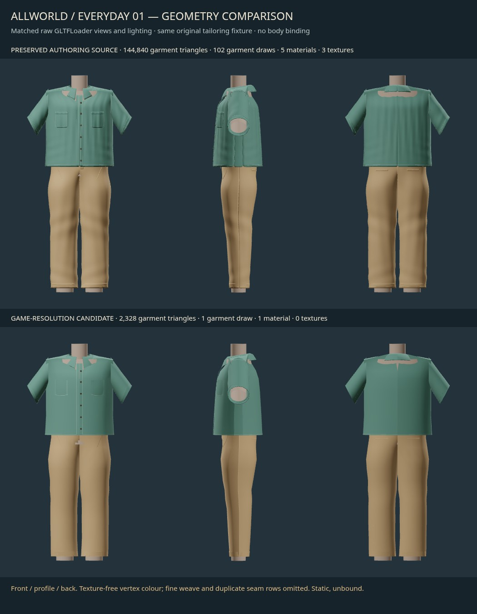

# Active continuation: practical geometry derivative

Parent resumed work after fd569373 and explicitly requested preserving the high-detail checkpoint, a Library sneak peek, current-budget inspection, a bounded game-resolution derivative, matched renders and then frozen-human morph fitting. This document supersedes the earlier checkpoint's stop instruction. Only this lane's two prefixes remain owned; no runtime, master body or caps changed.

## Library sneak peek delivered first

The existing inspected contact-sheet bytes (no rerender) were saved as **Allworld - static tailoring-form prototype - optimization pending.jpg**. Confirmed Library ID **libfile_2ff1a111c56c8191b7321be3f88ca0af**, file **file_00000000e95081f7ae83481c15e555fe**, version 0, 158,156 bytes. This is the original high-detail static form prototype, explicitly awaiting optimization at upload time. The upload copy and identity metadata remain in ignored `runs/library-upload/`.

## Current budget evidence

Read-only current main pin **1e8107d1f42e2b39de6b2b4fc866679c672996f9**. `src/scene/wardrobe/geometry.ts:213` enforces **3000 triangles per whole combination**; line147 enforces4000 per item but does not waive the stricter whole-combination cap. Line722 and `renderer.ts:107/172` specify one generated geometry, one vertex-colour material, one added draw, roughness .86 and no new textures. These inspected files match the integration-base versions byte for byte; exact hashes in `game-resolution-v1/receipts/budget-inputs.json`. No cap was increased.

The renderer additionally requires the body's skeleton/bind matrix, wardrobeUv/wardrobeCloth shader attributes, skin weights and conservative region coverage. The static GLB meets only the numeric geometry/material/texture envelope; it is **not wired into that renderer**, equipped, registered or eligible for production.

## Preserved high-detail versus game-resolution candidate

| Measured garment-only cost | High-detail source | Game-resolution v1 |
|---|---:|---:|
| Triangles | 144,840 | **2,328** |
| Mesh primitives / draws | 102 | **1** |
| Materials | 5 | **1** |
| Texture images | 3 | **0** |
| Encoded texture bytes | 177,211 | **0** |
| Decoded RGBA8 texture bytes before mipmaps | 786,432 | **0** |
| Decoded geometry typed-array bytes | 3,513,968 | **83,304** |
| Skin bindings | 0 | 0 |

Triangle reduction **98.39%**, leaving672 triangles under the existing3000 combination ceiling for this outfit. This headroom is not permission to add unmeasured equipment. Derivative GLB **85,088 bytes**, garment-only. The old3,808,680-byte GLB also contains15,360 fixture triangles, so those full-file sizes have different content and are not a pure geometry compression comparison.

Source: `game-resolution-v1/artifacts/everyday-01-game-v1-editable.blend`; export: `everyday-01-game-v1.glb`. Editable pieces remain separate in Blender, while a disposable export duplicate joins into one material/primitive. Original high-detail .blend/GLB/contact sheet are unchanged and remain hash-verified by the original `SHA256SUMS.json`.

Method: resample authored structured panel cages with chosen shoulder/knee/crotch rows; **no decimate modifier, edge-collapse loop or blind collapse**. Preserve collar, pockets, plackets, buttons, cuffs, selected seams and visible 2mm edge returns. Omit full hidden inner shells, duplicate stitch rows, subpixel thread cylinders, hidden belt loops and concealed fly. Source material sRGB pixels are averaged in linear space and baked to vertex colours. Zero normal maps/textures fits the existing material contract; this removes rather than suppresses the38 tangent-space warnings. New GLB validation is **0 errors / 0 warnings / 0 infos**, complete report.

Actual high/low neutral front/profile/back and garment close-up views were rendered under matched raw GLTFLoader lighting and inspected. [Close-up tradeoffs](../../../../experiments/cloud-lanes/human-wardrobe-art/game-resolution-v1/artifacts/high-vs-game-detail.jpg): same broad outfit silhouette and visible pocket/collar/placket cues; lower version is visibly smoother in cloth detail, more faceted at cuffs/collar, with reduced pocket depth and no fine weave. Collar/shoulder join defects are not resolved by optimization. This is a practical static geometry candidate, not final realism or wearable-fit acceptance.

## Checks and limits

Source build/export **1.637s /357,871,616B** sampled process-tree RSS; glTF validation **.104s /34,111,488B**; two matched comparison captures **4.143s /915,968,000B**. Existing heavy1 and1536MiB cap, two Blender threads, one owned loopback server/browser. All processes closed, no page errors or failed requests. No physical-device or sustained frame-time claim. `measure_game.py` independently measures the GLB and checks finite vertices/normals/colours, <=3000triangles, one primitive/material, no textures/skin, and no near-zero-area triangles. Intentional narrow seam ribbons/edge returns are identified in the build mapping; no collapse-created slivers are claimed as quality.

## New frozen-human input, not yet fitted at this checkpoint

Parent supplied human task01a13667-6b47-7763-b71a-7d06139ed03f's exact commit **3ee5882c8efde54c00fddaa6cbdbc8d1bca48b8a**. Verified fit-frame SHA-256 **51fae932279d1513e16c4d06ce633f6218a994fe6c224bc3436e105cc519083b**, source .blend **36018022ff64367e7426069d7417625a3591f3a2c0684c628c11c3bd908f84d9**, GLB **5f0f8da1f3e6b14fc4910f04f02ed1eafe6446f896f44ef2b3a23f2ca071bc07**. Frozen bytes are in ignored `runs/frozen-human-3ee5882/`, extracted with `git show` and never edited. Hash receipt includes topology/UV measurement packet and construction source.

Important source limitation: the producer supplies a **clothed torso/leg envelope**, not an independent undressed body, and **no skeleton**. Next derivative must be labelled an envelope overlay, preserve master bytes, test all six implemented identity controls at extremes plus height/shoulder combinations, measure actual intersections, and render neutral/extreme results. No final body fit, animation, pose binding or production readiness can be claimed from this input. Do not resume the 144k garment for fitting: use the2328-triangle derivative.
