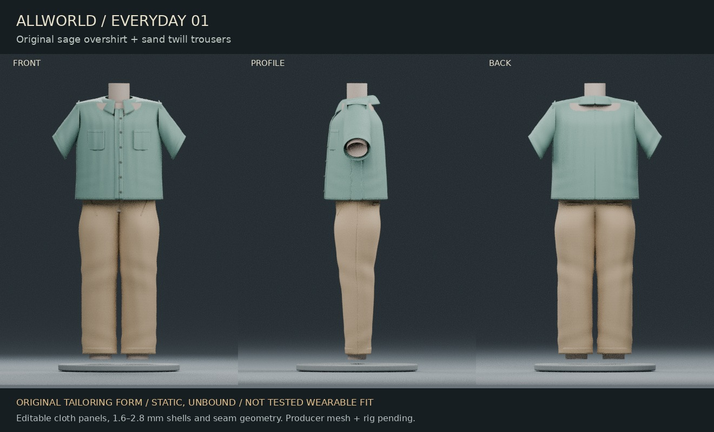

# Everyday 01 / original wardrobe checkpoint

One original sage cotton overshirt and sand twill trouser set on a **labelled original tailoring form**. Static and unbound; not tested wearable fit. Read [CONTINUE.md](CONTINUE.md) before continuing.

- [Editable Blender source](../../../../experiments/cloud-lanes/human-wardrobe-art/artifacts/everyday-01-tailoring-form.blend)
- [Uncompressed GLB](../../../../experiments/cloud-lanes/human-wardrobe-art/artifacts/everyday-01-on-form.glb)
- [Exported measurements](../../../../experiments/cloud-lanes/human-wardrobe-art/receipts/export-measurements.json)
- [Mask/binding proposal and blocked fit tests](../../../../experiments/cloud-lanes/human-wardrobe-art/fit-proposal.json)

In Blender, use collections `01_OVERSHIRT_editable_panels` and `02_TROUSERS_editable_panels`; hide `90_ORIGINAL_TAILORING_FORM_NOT_HUMAN_MASTER` for clothes alone. Cloth materials expose colour textures, roughness and normal strength. The `.blend` retains separate panel meshes, shell/subdivision modifiers and editable seam curves; GLB contains evaluated static meshes. Presentation ground/lights/camera/plinth are excluded from export. No bones, expression controls, production character source or wardrobe IDs were modified.

All dimensions are authored in metres. Blender Z-up/-Y-front exports to glTF Y-up/+Z-front. Origin remains ground centre `[0,0,0]`; garment hems start above it. Export bounds include the fixture, from `[-0.363256,0.096,-0.167549]` to `[0.363256,1.595,0.182293]` in glTF coordinates. These are exported artifact measurements, not human/survey measurements. No animation, mobile performance or current-game fit is claimed.
