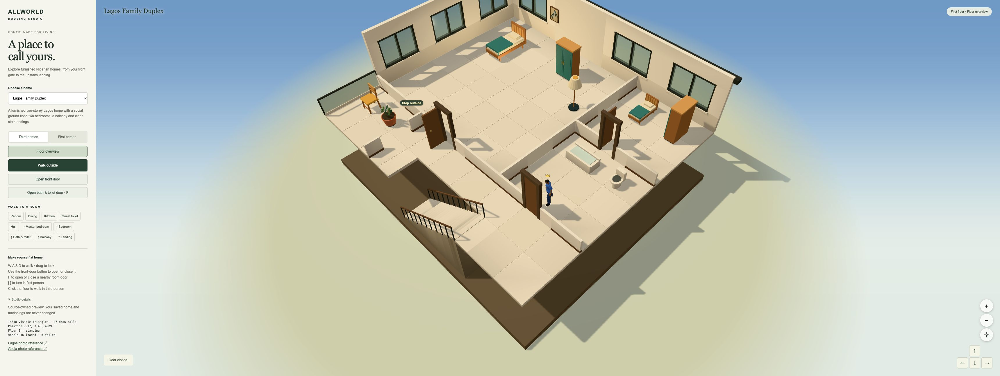

# Housing studio local acceptance

Recorded 15 October 2026. This is an isolated playable candidate on `codex/housing-studio-20261015`, based on first-person dependency `73f66122c42c70bba4e4128cde901865d2a39c7b`. It is not merged, deployed or user-approved visual work.

## Try it

The built preview is running on this Mac at <http://127.0.0.1:4435/housing-studio.html>. Choose a home, select **Walk inside**, then use WASD/arrows or the on-screen movement controls. Room buttons walk along the existing navigation grid and stair routes. Switch camera mode and drag the scene to look. Approach an internal door and press F or the room-door button. **Walk outside** follows the route to the existing front-door transition.

## Browser journeys

Primary-agent inspection used the actual built page in Chrome, without injecting gameplay state. All four recipes were entered from the compound and visited in both camera modes.

| Home | Observed journey | Loaded model instances |
| --- | --- | ---: |
| Lagos Family Duplex | Entry, dining, internal door close/F reopen, master bedroom at y=3.43, downstairs parlour at y=0.03, front-door exit | 16; zero failed |
| Lagos Two-room Apartment | Entry, second room, both views, phone-width movement and exit | 6; zero failed |
| Lagos Two-bedroom Apartment | Entry, dining, both views and exit; phone-width layout | 12; zero failed |
| Abuja Courtyard Mansion | Entry, both stair flights to roof terrace at y=6.83, master bedroom at y=3.43, return through front door | 21; zero failed |

Final roof arrival was repeated against `housing-studio-DPYkFblY.js`: floor 2, position (2.50, 6.83, 1.43), standing, 21 loaded models, no failed models. The final browser console capture contained no warning/error entries. These observations establish the exercised paths, not exhaustive navigation or sustained device performance.

Phone checks used a 390×844 Chrome viewport and pointer-held walk controls. Movement changed the two-room apartment avatar position from (7.85, 0.03, -1.91) to (7.74, 0.03, -1.28), then stopped on release. This is desktop emulation, not physical-phone acceptance.

Inspection led to fixes for floating terrace facade bands, missing interior-door lintels, wall art crossing window openings, TV console support, phone heading overlap, and missing shared control/tag positioning. Final zoom-button clicks kept the canvas at y=0 with scene scrollTop=0; the earlier misplaced tag SVG no longer pushed the canvas out of view.

## Automated checks and package

- `node --experimental-strip-types --test src/housing-studio/*.test.ts`: **12 passed, 0 failed**, final duration about 0.99 seconds. Coverage includes valid fixtures, legacy floor representation, room/stair reachability, exterior collision/door lifecycle, internal door reopening and floor changes, actual Home adapter contracts, asset hashes and scenery budgets.
- Scoped TypeScript project: `scripts/housing/tsconfig.json` — **passed, exit 0** after the integration owner released its heavy slot.
- Scoped Vite build: **passed**, 1.91 seconds. No production entry/configuration/package/lockfile changed. The generic large-chunk warning remains: this standalone preview includes the shared runtime in one large entry.
- Conservative scenery maximum: **13,920 / 15,000 triangles**, mansion first floor in first person. The audit includes the built shell, furnishings, internal doors and retained Home scenery; it adds near-LOD asset triangles on top of their fallbacks conservatively. Existing avatar geometry belongs to the separately approved character allowance. The on-screen renderer counter includes characters and can therefore exceed 15,000.
- Selected furniture: **12 GLBs, 164,752 bytes**; hashes match the pinned owned asset library. No external photos or downloaded third-party models are shipped.
- Standalone package: **40 files, 4,635,737 bytes**. Largest entry: **3,349,289 bytes**, **932,789 bytes gzip at level 9**. Exact output hashes are in [package-receipt.json](package-receipt.json). These are studio-package figures, not a production startup-budget certificate.

## Preserved boundaries and remaining acceptance

Only additive housing paths and their records are included. The studio uses an in-memory visit and does not write saved homes, inventory, ownership or customization. Existing shared Home, venue-world, first-person and avatar files are unchanged. No new PR, main push or deployment was created.

Closed internal doors block their openings; rooms with another entrance may still be reached by an alternative route. Opening is instantaneous. Leaving the house returns to the compound entrance through the existing scene callback rather than continuous interior streaming. This is a compact game treatment informed by real Lagos/Abuja references, not a photoreal architectural reconstruction.

Integration into the main game, hosted CI, final production download budgets, physical-device performance and release remain with the integration owner. The full 530-asset integration remains in its existing phase-one lane; the 12-file studio subset can be deduplicated when that adapter is adopted.

## Captured views

## User-review correction

The initial screenshot showed a low camera cutaway with full-height door frames and missing partitions. Normal third person now retains full-height interior walls and starts farther back and higher. Floor overview is an explicit toggle that resets the camera and lowers the partitions. Stair tops retain a small landing cap. First person remains enclosed with ceilings.

Doors are retained for private rooms; redundant privacy openings are filled visually and blocked in the same navigation projection. Public social-room gaps remain open passages. There are four internal doors in the duplex, two in the compact apartment, four in the two-bedroom apartment and six in the mansion. The duplex ground floor has only the guest-toilet door. The selector verifies furnished room/stair reachability before sealing each candidate, rather than inferring it from room adjacency. All recipe room/stair routes pass the focused checks.

Open/Close front door changes only manual door state. It does not trigger travel or move the avatar. Closing is rejected when the avatar is in its footprint. Walk inside/Walk outside retain the host traversal animation and return the front door to closed afterwards. F operates the nearest room or front door on the current floor. Existing front-door and interior tests exercise manual persistence, no position change, transit yielding, enclosure/overview, and retained privacy-door collision.

This correction initially built as `housing-studio-Cpt9b-AG.js`; its framing, overview, independent front-door controls and stair route passed the subsequent browser checkpoint. The current spatial build below supersedes that entry. Initial screenshots above remain historical evidence.

## Object-clearance follow-up

The updated source loads `housing-studio-DYmVz1Sz.js`. See [spatial verification](spatial-verification.md) for the confirmed bathroom door/tub defect and the correction. Actual loaded-model and fallback bounds, door sweeps and both open/closed leaf geometry now pass across all four recipes. Door widths are capped at 0.9 m, their hinges/swing directions avoid obstacles, and unused doorway width is filled. Open leaves now block walking as well as closed leaves.

During an explicitly released browser window, the prior `48932aab` framing, floor overview, independent front-door controls and actual upstairs route passed. That browser check also reproduced the bathroom door/tub intersection. The final `housing-studio-DYmVz1Sz.js` build subsequently passed its own bounded localhost-only Chrome check: bathroom leaves visibly clear the tub in both states, close/reopen preserves position, and attempts to walk through the closed leaf halt at z=4.60. First-person enclosure, third-person partitions, overview, stair ascent/descent and exit passed; final compound position (-10.10, 0, 11.68). No console warning/error entries were captured. Open-leaf approach and occupied-sweep rejection have automated coverage but were not separately browser-exercised. Chrome was returned to the integration owner immediately.

